# VaadaKaro — Backend Portal Connections & Workflows

Every portal's backend is connected to the others through **shared MongoDB collections**, **cross-portal notifications**, and **audit logs**. Here's exactly how.

---

## Architecture Diagram

```mermaid
graph TB
    subgraph Auth["Auth Layer"]
        SIGNUP["Signup (always CITIZEN)"]
        LOGIN["Login → JWT"]
    end

    subgraph Citizen["Citizen Portal"]
        C_COMPLAINT["File Complaint"]
        C_TRACK["Track Complaint"]
        C_REPLY["Reply to Info Request"]
        C_DRAFT["AI Draft Letter"]
        C_DOC["Save/Edit Document"]
        C_BOOK["Book Lawyer"]
        C_CANCEL["Cancel Booking"]
        C_GRIEVANCE["File Grievance"]
        C_ACCOUNT["Export/Delete Account"]
    end

    subgraph Officer["Officer Portal"]
        O_STATS["View Stats"]
        O_LIST["List Complaints (own dept)"]
        O_STATUS["Change Status"]
        O_ASSIGN["Assign Officer"]
        O_INFO_REQ["Request More Info"]
    end

    subgraph Lawyer["Lawyer Portal"]
        L_PROFILE["Create/Edit Profile"]
        L_STATS["View Stats"]
        L_CONFIRM["Confirm Booking"]
        L_DECLINE["Decline Booking"]
        L_COMPLETE["Complete Booking"]
    end

    subgraph Admin["Admin Portal"]
        A_ROLES["Change User Roles"]
        A_VERIFY["Verify Lawyer"]
        A_AUTHORITY["Manage Authority Dir"]
        A_REPORTS["Monthly Reports"]
        A_METRICS["Pilot Metrics"]
        A_GRIEVANCE["Handle Grievances"]
        A_BREACH["Record Data Breach"]
        A_AUDIT["View Audit Logs"]
    end

    subgraph Shared["Shared Services"]
        NOTIFY["Notification Service"]
        AUDIT["Audit Log Service"]
        DB["MongoDB Atlas"]
    end

    %% Citizen → Officer
    C_COMPLAINT -->|"creates in complaints collection"| O_LIST
    C_REPLY -->|"notifies assigned officer"| O_LIST

    %% Officer → Citizen
    O_STATUS -->|"notifies citizen"| C_TRACK
    O_ASSIGN -->|"notifies citizen"| C_TRACK
    O_INFO_REQ -->|"notifies citizen"| C_REPLY

    %% Citizen → Lawyer
    C_BOOK -->|"notifies lawyer"| L_CONFIRM

    %% Lawyer → Citizen
    L_CONFIRM -->|"notifies citizen + shares contact"| C_CANCEL
    L_DECLINE -->|"notifies citizen"| C_CANCEL
    L_COMPLETE -->|"notifies citizen"| C_CANCEL

    %% Citizen → Admin
    C_BOOK -->|"feeds booking metrics"| A_METRICS
    C_COMPLAINT -->|"feeds complaint reports"| A_REPORTS
    C_DRAFT -->|"feeds draft metrics"| A_METRICS
    C_GRIEVANCE -->|"enters grievance queue"| A_GRIEVANCE

    %% Admin → Lawyer
    A_ROLES -->|"grants LAWYER role"| L_PROFILE
    A_VERIFY -->|"notifies lawyer"| L_PROFILE

    %% Admin → Officer
    A_ROLES -->|"grants OFFICER role + dept"| O_LIST

    %% Admin → Citizen
    A_BREACH -->|"notifies affected users"| NOTIFY
    A_GRIEVANCE -->|"notifies on resolution"| NOTIFY

    %% AI → Authorities (admin-maintained)
    C_DRAFT -->|"matches from authority directory"| A_AUTHORITY

    %% Everything → Audit
    C_COMPLAINT --> AUDIT
    O_STATUS --> AUDIT
    L_CONFIRM --> AUDIT
    A_ROLES --> AUDIT
    A_VERIFY --> AUDIT
    A_BREACH --> AUDIT
```



---

## Workflow 1: Complaint Lifecycle (Citizen ↔ Officer ↔ Admin)

This is the **primary cross-portal workflow** connecting 3 portals.

### Flow

```
Citizen files complaint → Officer sees it in department queue → Officer acts → Citizen gets notified
```

### Backend Connections

| Step | Route | Portal | Touches | Notifies |
|---|---|---|---|---|
| 1. Citizen files | `POST /complaints` | Citizen | `complaints` collection, `audit_logs` | Citizen (confirmation) |
| 2. Officer sees it | `GET /officer/complaints` | Officer | reads `complaints` filtered by `department` | — |
| 3. Officer assigns | `POST /officer/complaints/{id}/assign` | Officer | updates `complaints.assigned_officer_id`, auto-sets `UNDER_REVIEW` | **→ Citizen** ("Officer assigned") |
| 4. Officer changes status | `PATCH /officer/complaints/{id}/status` | Officer | updates `complaints.status`, adds to `updates[]` | **→ Citizen** ("Complaint Under Review / Resolved / etc.") |
| 5. Officer requests info | `PATCH /officer/complaints/{id}/status` (status=`INFO_REQUESTED`) | Officer | updates status | **→ Citizen** ("More information needed") |
| 6. Citizen replies | `POST /complaints/{id}/reply` | Citizen | sets status back to `UNDER_REVIEW`, adds update | **→ Officer** ("Citizen responded") |
| 7. Admin sees reports | `GET /admin/reports` | Admin | aggregates `complaints` by department + status | — |
| 8. Admin sees metrics | `GET /admin/metrics` | Admin | counts from `audit_logs` + `complaints` resolution times | — |

### Shared Data
- **`complaints` collection**: Written by Citizen, read/updated by Officer, aggregated by Admin
- **`notifications` collection**: Officer actions trigger citizen notifications and vice versa
- **`audit_logs`**: Every action logged, fed into Admin's pilot metrics

### Code Connections
- [complaints.py](file:///d:/parmeshwarsharma/vaadakaro/backend/app/api/routes/complaints.py) → creates complaint, notifies citizen
- [officer.py](file:///d:/parmeshwarsharma/vaadakaro/backend/app/api/routes/officer.py) → reads/updates same complaint, notifies citizen
- [replies.py](file:///d:/parmeshwarsharma/vaadakaro/backend/app/api/routes/replies.py) → citizen replies, notifies assigned officer
- [admin.py L66-L116](file:///d:/parmeshwarsharma/vaadakaro/backend/app/api/routes/admin.py#L66-L116) → aggregates complaints for reports
- [admin.py L123-L177](file:///d:/parmeshwarsharma/vaadakaro/backend/app/api/routes/admin.py#L123-L177) → counts audit events for metrics

---

## Workflow 2: Lawyer Booking Lifecycle (Citizen ↔ Lawyer ↔ Admin)

### Flow

```
Admin gives LAWYER role → Lawyer creates profile → Admin verifies → Citizen books → Lawyer confirms → Contact shared
```

### Backend Connections

| Step | Route | Portal | Touches | Notifies |
|---|---|---|---|---|
| 1. Admin grants role | `PATCH /admin/users/{id}/role` | Admin | `users.role` → `LAWYER` | — |
| 2. Lawyer creates profile | `PUT /lawyer/profile` | Lawyer | `lawyer_profiles` collection | — |
| 3. Admin verifies | `PATCH /admin/lawyers/{id}/verify` | Admin | `lawyer_profiles.is_verified` | **→ Lawyer** ("Profile verified") |
| 4. Citizen browses | `GET /lawyers` | Citizen | reads `lawyer_profiles` + `users` (only LAWYER role) | — |
| 5. Citizen books | `POST /lawyers/{id}/bookings` | Citizen | creates `bookings` (status=`PENDING`) | **→ Lawyer** ("New consultation request") |
| 6. Lawyer confirms | `PATCH /lawyer/bookings/{id}` (status=`CONFIRMED`) | Lawyer | updates `bookings.status` | **→ Citizen** ("Consultation confirmed") |
| 7. Contact shared | `GET /bookings` | Citizen | `bookings` with `CONFIRMED`/`COMPLETED` status → email+phone revealed | — |
| 8. Lawyer declines | `PATCH /lawyer/bookings/{id}` (status=`CANCELLED`) | Lawyer | updates status, optional note | **→ Citizen** ("Consultation declined") |
| 9. Citizen cancels | `POST /bookings/{id}/cancel` | Citizen | updates status | **→ Lawyer** ("Consultation cancelled") |
| 10. Lawyer completes | `PATCH /lawyer/bookings/{id}` (status=`COMPLETED`) | Lawyer | updates status | **→ Citizen** ("Consultation completed") |
| 11. Admin sees metrics | `GET /admin/metrics` | Admin | counts `bookings` by status | — |

### Contact-sharing logic ([bookings.py L17-L34](file:///d:/parmeshwarsharma/vaadakaro/backend/app/api/routes/bookings.py#L17-L34))
```python
_SHARES_CONTACT = {BookingStatus.CONFIRMED, BookingStatus.COMPLETED}
# Email and phone only visible when status is in _SHARES_CONTACT
```

### Shared Data
- **`users` collection**: Admin changes role, Lawyer profile references `user_id`
- **`lawyer_profiles`**: Created by Lawyer, verified by Admin, browsed by Citizen
- **`bookings`**: Created by Citizen, managed by Lawyer, counted by Admin metrics

### Code Connections
- [admin.py L228-L249](file:///d:/parmeshwarsharma/vaadakaro/backend/app/api/routes/admin.py#L228-L249) → role change (creates officers/lawyers)
- [admin.py L200-L225](file:///d:/parmeshwarsharma/vaadakaro/backend/app/api/routes/admin.py#L200-L225) → verify lawyer, notify lawyer
- [lawyers.py](file:///d:/parmeshwarsharma/vaadakaro/backend/app/api/routes/lawyers.py) → citizen browses + books
- [lawyer_portal.py](file:///d:/parmeshwarsharma/vaadakaro/backend/app/api/routes/lawyer_portal.py) → lawyer manages bookings, notifies citizen
- [bookings.py](file:///d:/parmeshwarsharma/vaadakaro/backend/app/api/routes/bookings.py) → citizen views/cancels bookings, notifies lawyer

---

## Workflow 3: AI Letter Drafting → Authority Directory (Citizen ↔ Admin)

### Flow

```
Admin maintains authority directory → Citizen drafts letter → AI suggests department → Backend matches authorities
```

### Backend Connections

| Step | Route | Portal | Touches |
|---|---|---|---|
| 1. Admin seeds/creates authorities | `POST /admin/authorities` | Admin | `authorities` collection |
| 2. Admin verifies entries | `PUT /admin/authorities/{id}` | Admin | sets `last_verified_at` |
| 3. Citizen drafts letter | `POST /ai/draft-letter` | Citizen | calls Gemini → gets `department_group` |
| 4. Backend matches authorities | `match_authorities()` | Citizen | queries `authorities` by department + location |
| 5. Citizen saves document | `POST /documents` | Citizen | `legal_documents` collection |
| 6. Admin sees metrics | `GET /admin/metrics` | Admin | counts `LETTER_DRAFTED`, `DOCUMENT_SAVED` from audit logs |

### Code Connection
- [ai.py L33-L58](file:///d:/parmeshwarsharma/vaadakaro/backend/app/api/routes/ai.py#L33-L58) → drafts letter, calls `match_authorities()`
- [authorities.py L61-L86](file:///d:/parmeshwarsharma/vaadakaro/backend/app/api/routes/authorities.py#L61-L86) → matches admin-maintained entries

---

## Workflow 4: Grievance Officer Queue (Citizen/Guest ↔ Admin)

### Flow

```
Citizen/Guest files grievance → Admin sees in queue → Admin resolves → Citizen notified
```

### Backend Connections

| Step | Route | Portal | Notifies |
|---|---|---|---|
| 1. Anyone files | `POST /grievances` | Citizen/Guest | **→ Citizen** ("Request received, due by...") |
| 2. Admin sees queue | `GET /admin/grievances` | Admin | — |
| 3. Admin resolves | `PATCH /admin/grievances/{id}` | Admin | **→ Citizen** ("Reply to request GRV-...") |

### Code Connection
- [grievances.py](file:///d:/parmeshwarsharma/vaadakaro/backend/app/api/routes/grievances.py) — both citizen-facing and admin-facing routes in one file

---

## Workflow 5: Data Breach Handling (Admin → All Users)

### Flow

```
Admin records breach → System notifies all affected users → Admin marks reports filed
```

### Backend Connections

| Step | Route | Notifies |
|---|---|---|
| 1. Admin creates breach | `POST /admin/breach-notices` | **→ Every affected user** (in-app notification with what happened, consequences, mitigation) |
| 2. Admin marks CERT-In reported | `PATCH /admin/breach-notices/{id}` | — |
| 3. Admin marks Board reported | `PATCH /admin/breach-notices/{id}` | — |

### Code Connection
- [breaches.py](file:///d:/parmeshwarsharma/vaadakaro/backend/app/api/routes/breaches.py) — admin creates, system mass-notifies

---

## Workflow 6: Account Deletion (Citizen → impacts all portals)

### Flow

```
Citizen deletes account → System cleans up across ALL collections
```

### What happens to cross-portal data ([account.py L184-L239](file:///d:/parmeshwarsharma/vaadakaro/backend/app/api/routes/account.py#L184-L239)):

| Data | Action | Impact on other portal |
|---|---|---|
| Untouched complaints (SUBMITTED) | **Deleted** | Removed from Officer's queue |
| Acted-on complaints | **Anonymised** (`citizen_id` → `"deleted-user"`, location/attachments cleared) | Officer keeps the complaint record |
| Open bookings (citizen side) | **Cancelled** | **→ Lawyer notified** ("citizen closed account") |
| Open bookings (lawyer side) | **Cancelled** | **→ Citizen notified** ("lawyer left platform") |
| Lawyer profile | **Deleted** | Removed from public directory + Admin's list |
| Documents, AI history, notifications, settings | **Deleted** | — |
| Grievance requests | **Anonymised** (name → "Deleted user") | Admin keeps the handling record |
| Consent records + Audit logs | **Kept** (ids only) | Admin retains proof |

---

## Cross-Portal Notification Map

Every `notify()` call creates a record in the `notifications` collection that appears in the recipient's notification bell.

| Sender Portal | Action | → Recipient Portal | Notification |
|---|---|---|---|
| **Citizen** | Files complaint | → Citizen | "Complaint registered" |
| **Officer** | Changes status | → **Citizen** | "Complaint [status]. Remarks: ..." |
| **Officer** | Assigns officer | → **Citizen** | "Officer assigned to your complaint" |
| **Officer** | Requests info | → **Citizen** | "More information needed" |
| **Citizen** | Replies to info req | → **Officer** | "Citizen responded to your info request" |
| **Citizen** | Books lawyer | → **Lawyer** | "New consultation request" |
| **Lawyer** | Confirms booking | → **Citizen** | "Consultation confirmed" |
| **Lawyer** | Declines booking | → **Citizen** | "Consultation declined" |
| **Lawyer** | Completes booking | → **Citizen** | "Consultation completed" |
| **Citizen** | Cancels booking | → **Lawyer** | "Consultation cancelled" |
| **Admin** | Verifies lawyer | → **Lawyer** | "Profile verified" / "Verification removed" |
| **Admin** | Records breach | → **All affected** | "Data security incident: ..." |
| **Admin** | Resolves grievance | → **Citizen** | "Reply to request GRV-..." |
| **Citizen** | Files grievance | → **Citizen** | "Request received" |
| **System** | Account deleted | → **Lawyer** | "Citizen closed account, booking cancelled" |
| **System** | Account deleted | → **Citizen** | "Lawyer left, booking cancelled" |

---

## Shared Collections: Who Reads / Writes What

| Collection | Citizen | Officer | Lawyer | Admin |
|---|---|---|---|---|
| `users` | Read (self) | Read (citizen names) | Read (self) | **Read + Write** (role changes) |
| `complaints` | **Create + Read** (own) | **Read + Update** (own dept) | — | **Read** (reports/metrics) |
| `bookings` | **Create + Cancel** | — | **Read + Update** (confirm/decline/complete) | **Read** (metrics) |
| `lawyer_profiles` | **Read** (directory) | — | **Create + Update** (own) | **Read + Write** (verify) |
| `authorities` | **Read** (directory + letter drafter) | — | — | **CRUD** |
| `legal_documents` | **CRUD** | — | — | — |
| `notifications` | **Read** (own) | **Read** (own) | **Read** (own) | — |
| `audit_logs` | — | — | — | **Read** (logs + metrics) |
| `consent_records` | — | — | — | — (kept for proof) |
| `grievance_requests` | **Create + Read** (own) | — | — | **Read + Update** |
| `breach_notices` | — | — | — | **CRUD** |
| `ai_legal_history` | **Read** (own history) | — | — | — |

---

## Role-Based Access Control ([deps.py](file:///d:/parmeshwarsharma/vaadakaro/backend/app/api/deps.py))

| Dependency | Who gets in | Used by |
|---|---|---|
| `CurrentUser` | Any authenticated user | Complaints, documents, bookings, notifications, account |
| `Officer` | OFFICER or ADMIN | Officer routes |
| `Lawyer` | LAWYER only | Lawyer portal routes |
| `Admin` | ADMIN only | Admin routes, breaches, grievance admin |
| `AIUser` | Any user with `ai_consent=True` | AI routes (analyze, draft, legal-docs) |
| `OptionalUser` | Authenticated or guest | Legal advice, tracking, grievances |

---

## Summary

All 4 portals are **fully connected** through:

1. **Shared MongoDB collections** — complaints, bookings, lawyer_profiles, authorities, grievances, breaches are written by one portal and read/updated by another
2. **Cross-portal notifications** — 16+ notification types flow between portals via `notify()`
3. **Audit log pipeline** — every portal writes to `audit_logs`, Admin reads them for reports, metrics, and compliance
4. **Role-based gating** — Admin creates Officers and Lawyers through role changes; the role determines which routes are accessible
5. **Account deletion cascade** — a citizen deleting their account triggers cleanup and notifications across all portal data
